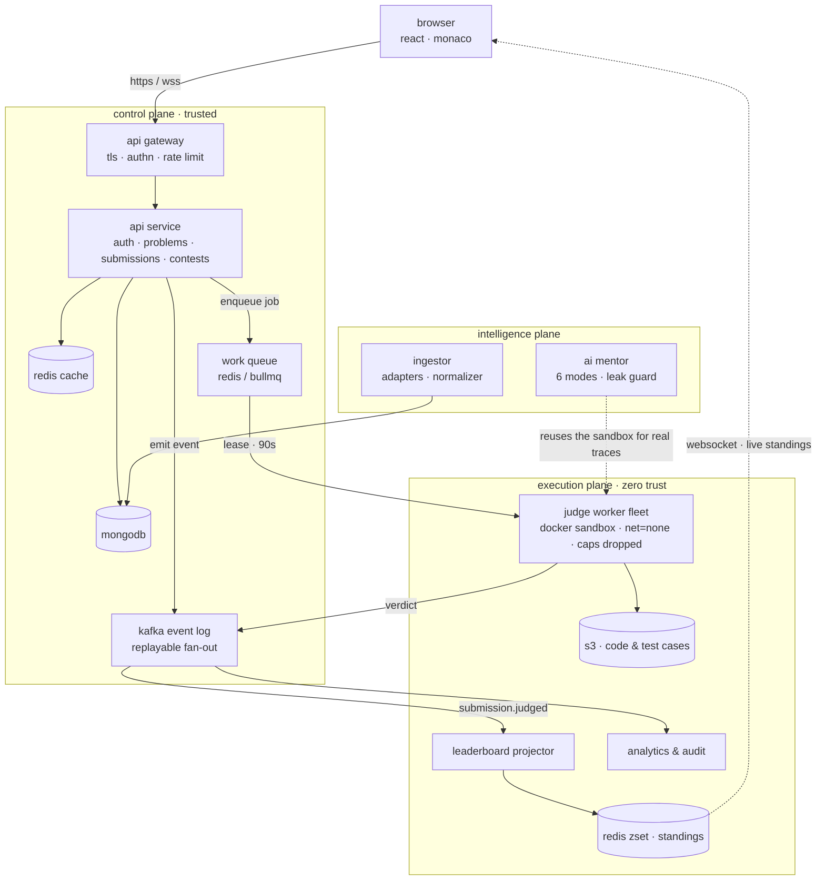
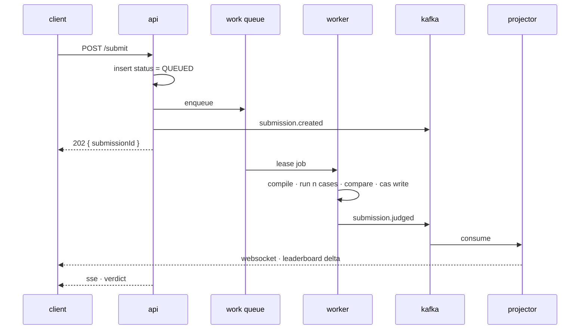
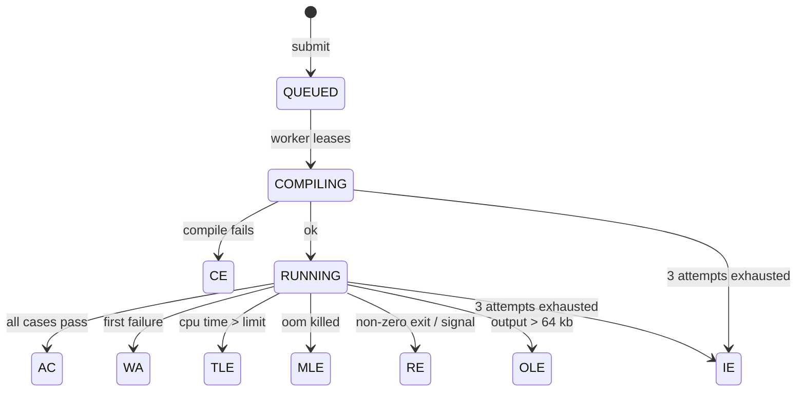

# online judge

a sandboxed, queue-backed online judge that scales from a localhost mvp to an autoscaled judge fleet — with an ai mentor whose answers are grounded in real execution, not an llm's guess.

> **online judge = online compiler + processing logic.** build the compiler correctly and the judge is a thin layer on top.

## architecture

three planes with different trust levels, different scaling curves and different failure blast radii. untrusted code runs only inside the execution plane; the api never compiles or executes anything.



## how a submission is judged

the request path and the verdict path are different paths. the api acknowledges in under 200 ms and exits; the verdict arrives later over a channel the client is already holding open.



## verdict lifecycle

every terminal state is written exactly once, by a compare-and-set against the pending states. a worker whose write matches zero documents knows another worker already finished, and exits quietly.



`IE` is *our* failure, not the user's — it is the state that keeps a poison-pill submission from blocking the queue.

## the x-factor: an ai mentor that executes, not guesses

six modes mapped to the places a learner actually gets stuck. two of them are only possible because the execution plane already exists:

| mode | stage | grounded in |
|---|---|---|
| intuition engine | "i have no clue" | statement + constraints → pattern, edge cases |
| brainstorming partner | "i have a clue, started" | partial logic → gap analysis |
| **dry-run simulator** | "written an approach, unsure" | **real execution** — instrumented run in the sandbox, actual variable trace |
| **complexity auditor** | "solved but tle" | **real measurement** — runtimes at n = 10²…10⁵ fitted to a curve |
| conceptual translator | "don't understand this data structure" | metaphors, invariants, no code |
| foundations architect | "new to this data structure" | primitives, then 3 canonical problems from the catalogue |

the mentor is optional by construction: no inbound import from the judge path, a read-only db credential, its own deployment and a kill switch. a chaos drill scales it to zero mid-contest and judging must be unaffected.

## roadmap

| version | level | theme | what lands |
|---|---|---|---|
| **v0** | l1–l2 | skeleton | express + mongo + react, jwt auth, problem crud, monaco, `/run` on the host. **localhost only, never deployed; deleted once v1 landed.** |
| **v1** | l3 | product | docker sandbox, test cases, real verdicts, async `/submit` via bullmq, contests, profile. one compose stack on one box. |
| **v2** | l4a | distributed | kafka event backbone, event-sourced live leaderboard, s3 test cases, autoscaled workers, gateway, tracing. |
| **v3** | l4b | intelligence | ai mentor — six modes, execution-grounded, leak guard, token budgets. |
| **v4** | l4c | hardening | load tests, chaos drills, golden-verdict suite, blue/green, runbooks. |

## repository layout

```
oj/
├── apps/
│   ├── web/                    react + vite + monaco, mentor panel
│   ├── api/                    express: auth, problems, submissions, contests, sse, ws
│   ├── judge-worker/           queue consumer → sandbox → verdict (+ outbox row)
│   ├── outbox-relay/           outbox rows → redis streams
│   ├── leaderboard-projector/  stream consumer → redis zset → ws deltas
│   └── ai-mentor/              own process on :4002 — modes, context, guard, budget
├── packages/
│   ├── contracts/              zod schemas + event types, shared fe/be
│   ├── db/                     mongoose models, migrations, seed
│   ├── queue/                  bullmq queue and job definitions
│   ├── sandbox/                docker runner, limits, result parsing
│   ├── judge/                  comparators, verdict mapping, judge loop, standings, golden suite
│   ├── events/                 transport interface + redis streams (kafka stays gated)
│   ├── storage/                s3 / file object store, inline refs
│   ├── mentor/                 mode registry, complexity fitter, leak guard
│   └── telemetry/              prometheus registry, the hld metrics
├── runners/                    one dockerfile per language
├── load/                       k6 contest profile, zero-dep burst, token pool seeder
├── chaos/                      the three hld §14 drills as scripts
├── infra/                      compose (dev, prod), dockerfiles, nginx, k8s (keda, blue/green)
└── docs/                       hld, lld, runbooks, load results
```

## design docs

the whole system was designed before the first line of code.

- [high level design](docs/hld.html) · [pdf](docs/hld.pdf) — architecture, capacity model, security posture, tradeoffs
- [low level design](docs/LLD.md) · [pdf](docs/lld.pdf) — schemas, signatures, comparator edge cases, the outbox, every failure mode

regenerate the pdfs with `pnpm docs:pdf`.

## running locally

```bash
nvm use                        # node 22
pnpm install
pnpm stack:up                  # mongo + redis (minio: --profile s3, v2+)
cp .env.example .env
pnpm --filter @oj/db migrate   # indexes
pnpm --filter @oj/db seed      # sample problems
./runners/build.sh dev         # judge images (needs docker)
pnpm dev                       # api :4000, web :5173, judge worker
```

## status

`v4` — all four versions have landed locally.

- **v1** judging works end to end. submit goes through bullmq to a docker judge worker (one container per run, cpu time and peak rss from gnu time, read-only scratch, no network), the verdict is written by compare-and-set in the same transaction as its outbox row, and reaches the browser over sse. contests run with icpc standings.
- **v2** the outbox is relayed to redis streams behind an `EventTransport` (kafka stays gated until a second consumer exists), a projector keeps standings in a redis sorted set and pushes deltas over websocket, code and test cases go to s3 or a local store, every process exposes `/metrics`, and there are dockerfiles, a prod compose, an nginx gateway and k8s manifests with keda scaling workers on queue depth.
- **v3** the ai mentor runs as its own process on `:4002`. six modes; modes 3 and 4 run the learner's code in the sandbox first (a `sys.settrace` line trace, timings at four input sizes fitted to a growth class). the context is built server-side from sample cases only, a leak guard holds every code fence until it has seen it whole, a redis budget caps tokens per day and per user, identical questions are served from cache. no api key means a fake provider: the whole pipeline, no bill.
- **v4** a 31-fixture golden-verdict suite (every terminal state plus the containment cases) runs against real docker and is the blue/green promotion gate; three chaos drills (`kill -9` a worker mid-judge, flush redis mid-contest, stop the mentor) pass as scripts; a load generator measured `/submit` at 40 ms p95 and zero dropped submissions on a laptop (`docs/load-results.md`); runbooks cover the alerts that exist.

seed a setter account (`setter` / `setter-password`) and five problems with `pnpm --filter @oj/db seed`. the mentor panel appears on every problem page once `AI_ENABLED=true`.
