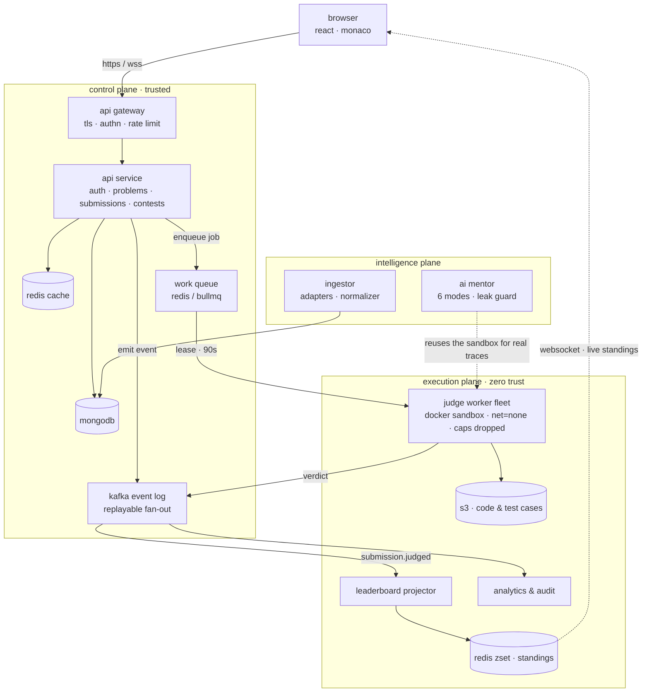
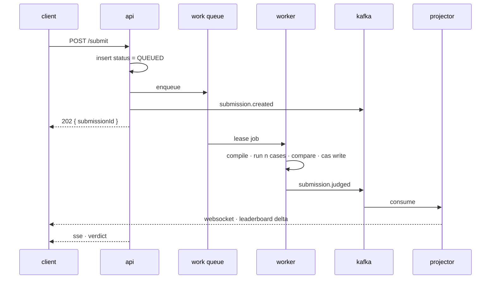
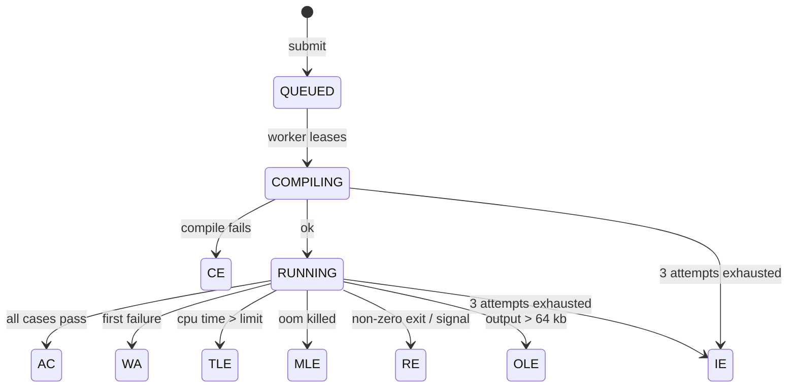

# online judge

a sandboxed, queue-backed online judge that scales from a localhost mvp to an autoscaled judge fleet — with an ai mentor whose answers are grounded in real execution, not an llm's guess.

> **online judge = online compiler + processing logic.** build the compiler correctly and the judge is a thin layer on top.

## architecture

three planes with different trust levels, different scaling curves and different failure blast radii. untrusted code runs only inside the execution plane; the api never compiles or executes anything.



## how a submission is judged

the request path and the verdict path are different paths. the api acknowledges in under 200 ms and exits; the verdict arrives later over a channel the client is already holding open.



## verdict lifecycle

every terminal state is written exactly once, by a compare-and-set against the pending states. a worker whose write matches zero documents knows another worker already finished, and exits quietly.



`IE` is *our* failure, not the user's — it is the state that keeps a poison-pill submission from blocking the queue.

## the x-factor: an ai mentor that executes, not guesses

six modes mapped to the places a learner actually gets stuck. two of them are only possible because the execution plane already exists:

| mode | stage | grounded in |
|---|---|---|
| intuition engine | "i have no clue" | statement + constraints → pattern, edge cases |
| brainstorming partner | "i have a clue, started" | partial logic → gap analysis |
| **dry-run simulator** | "written an approach, unsure" | **real execution** — instrumented run in the sandbox, actual variable trace |
| **complexity auditor** | "solved but tle" | **real measurement** — runtimes at n = 10²…10⁵ fitted to a curve |
| conceptual translator | "don't understand this data structure" | metaphors, invariants, no code |
| foundations architect | "new to this data structure" | primitives, then 3 canonical problems from the catalogue |

the mentor is optional by construction: no inbound import from the judge path, a read-only db credential, its own deployment and a kill switch. a chaos drill scales it to zero mid-contest and judging must be unaffected.

## roadmap

| version | level | theme | what lands |
|---|---|---|---|
| **v0** | l1–l2 | skeleton | express + mongo + react, jwt auth, problem crud, monaco, `/run` on the host. **localhost only, never deployed.** |
| **v1** | l3 | product | docker sandbox, test cases, real verdicts, async `/submit` via bullmq, contests, profile. one compose stack on one box. |
| **v2** | l4a | distributed | kafka event backbone, event-sourced live leaderboard, s3 test cases, autoscaled workers, gateway, tracing. |
| **v3** | l4b | intelligence | ai mentor — six modes, execution-grounded, leak guard, token budgets. |
| **v4** | l4c | hardening | load tests, chaos drills, golden-verdict suite, blue/green, runbooks. |

## repository layout

```
oj/
├── apps/
│   ├── web/                    react + vite + monaco
│   ├── api/                    express: auth, problems, submissions, contests
│   ├── judge-worker/           queue consumer → sandbox → verdict
│   ├── leaderboard-projector/  kafka consumer → redis zset
│   ├── ai-mentor/              mode router, context builder, leak guard
│   └── ingestor/               source adapters + normalizer
├── packages/
│   ├── contracts/              zod schemas + event types, shared fe/be
│   ├── db/                     mongoose models + migrations
│   ├── queue/                  bullmq queue and job definitions
│   ├── sandbox/                docker runner, limits, result parsing
│   └── events/                 kafka producer/consumer wrappers
├── runners/                    one dockerfile per language
├── infra/                      docker-compose (dev) · terraform + k8s (prod)
└── docs/                       hld, lld, build pipeline
```

## design docs

the whole system was designed before the first line of code.

- [high level design](docs/hld.html) · [pdf](docs/hld.pdf) — architecture, capacity model, security posture, tradeoffs
- [low level design](docs/LLD.md) · [pdf](docs/lld.pdf) — schemas, signatures, comparator edge cases, the outbox, every failure mode

regenerate the pdfs with `pnpm docs:pdf`.

## running locally

```bash
nvm use                        # node 22
pnpm install
pnpm stack:up                  # mongo + redis (minio: --profile s3, v2+)
cp .env.example .env
pnpm --filter @oj/db migrate   # indexes
pnpm --filter @oj/db seed      # sample problems
pnpm dev                       # api :4000, web :5173
```

## status

`v0` — runs locally. auth, problem catalogue, monaco editor and `/run` on the host executor. `submit` lands in v1 with the docker judge.

seed a setter account (`setter` / `setter-password`) and five problems with `pnpm --filter @oj/db seed`.
